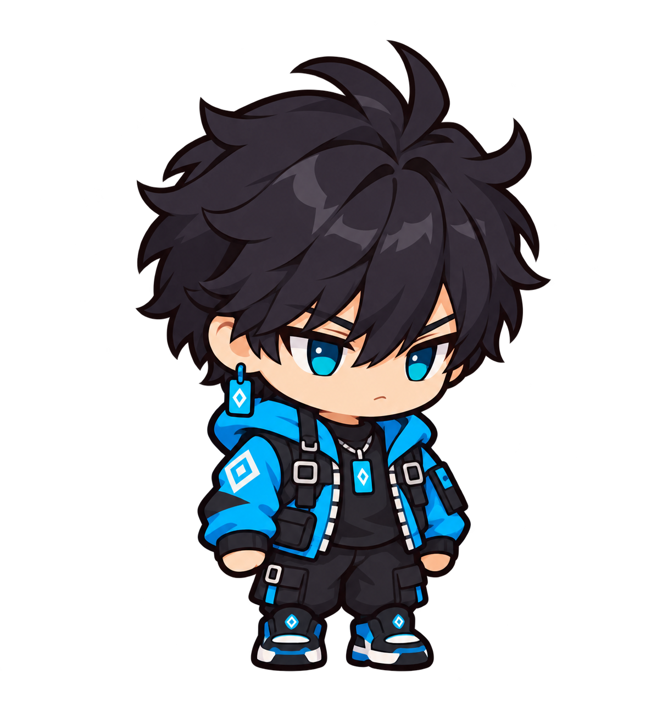

# 서울 히어로 신규 SD 캐릭터 10명 제작 계획

작성일: 2026년 10월 12일 · 상태: **방향 수정본 v02 10명 승인 / 이름·배경·고유 능력 및 게임 연결**

송진우의 큰 머리, 작은 몸, 아주 짧은 팔다리와 선명한 셀 채색을 기준으로 신규 캐릭터 10명을 만든다. 몸과 얼굴, 눈은 **송진우 실파일과 같은 약한 각도**로 맞춘다. 정면에 가까운 부드러운 3/4에서 살짝 우하단을 보며 얼굴과 양눈이 넓게 보여야 한다. 각성 전 서울에서 만날 법한 사람의 일상복과 성격이 보이도록 설계한다. 사용자는 아래 10명 콘셉트와 원화 제작·지정 폴더 저장을 2026-10-12 승인했다. 이후 제작 시 먼저 읽을 공통 방법은 [CHARACTER_GUIDE.md](../../../assets/characters-sd/CHARACTER_GUIDE.md)에 기록한다. 첫 10명의 방향 피드백을 반영한 수정본 v02를 제작했고, 사용자의 후속 승인으로 이름·배경·고유 능력과 함께 게임에 연결했다. [비교 갤러리](index.html)는 원화 확인용으로 유지한다.

## 송진우 원화 분석

기준은 현재 사용 중인 [song_sd_01.png](../../../assets/characters-sd/song_sd_01.png)다. 보존된 옛 전투 원화나 art-library의 다른 인물을 그림체 기준으로 섞지 않는다.



| 관찰 요소 | 신규 제작에 적용할 기준 |
| --- | --- |
| 머리와 몸의 비율 | 머리카락을 포함한 머리가 전체 높이의 약 60%. 전체 약 1.7등신, 작은 몸통, 몸 옆에 붙은 짧은 팔과 작은 두 신발. |
| 얼굴 방향 | 송진우 실파일의 실제 회전각과 카메라를 그대로 기준으로 삼는다. 정면에 가까운 부드러운 3/4이며 얼굴과 양눈이 넓게 보인다. 강한 옆얼굴로 돌리지 않는다. |
| 눈과 표정 | 큰 눈과 절제된 입 모양. 송진우처럼 동공은 살짝 아래로 향하고 홍채를 오른쪽 끝으로 몰지 않는다. 두 눈은 같은 지점을 보며 관객과 눈을 맞추지 않는다. |
| 외곽과 채색 | 굵고 둥근 짙은 외곽선, 큰 색면, 단순한 셀 그림자와 제한된 하이라이트. 피부와 얼굴의 대비를 유지한다. |
| 실루엣 | 머리카락은 큰 덩어리로 구분되고, 몸통 아래에 작은 신발 두 개가 분리된다. 손은 빈손이며 몸 옆에 보인다. |
| 캐릭터 식별 | 검은 헝클어진 머리, 청록 눈, 파란 짧은 재킷이 먼저 읽힌다. 신규 인물은 각자의 머리 실루엣과 옷의 큰 형태로 이 정도의 식별력을 만든다. |

송진우의 전술 끈·다이아몬드 장식·파란 후드를 모든 인물에게 복제하지 않는다. 신규 인물의 정체성은 아래 일상복에서 가져오며, 작은 장식은 최대 1~2개로 제한한다.

현역 기존 원화는 플레이어 송진우·강태훈·박도준 3명과 길드 한서아다. 강태훈의 군복, 박도준의 주황 구조복과 회색 수염, 한서아의 꽃핀과 헤드셋은 기존 인물의 식별 요소로 남긴다. 윤하린은 개성이 약하다는 사용자 요청으로 2026-10-12 퇴역하며, 과거 출처는 이력으로 보존한다.

## 송진우와 같은 약한 방향 제작 기준

기존 [송진우 생성 기록](../../../assets/characters-sd/provenance.json)은 `Front-facing slightly three-quarter view`, [추가 4종 기록](../../../assets/characters-sd/provenance-02.json)은 `facing slightly right`를 사용한다. 실제 방향 기준은 문구 해석보다 **송진우 실파일**을 우선한다. 첫 제작의 강한 남동쪽 지시는 사용자 피드백대로 송진우보다 옆보기 각도를 크게 만들었으므로 철회한다. 신규·수정 프롬프트는 아래 세 요소를 각각 지정한다.

1. **몸:** 송진우 실파일과 같은 실제 회전각과 카메라의 편안한 대기 자세. 보이는 앞면의 비율을 같게 맞추고 방향을 더 강하게 돌리지 않는다.
2. **머리:** 정면에 가까운 부드러운 3/4로 살짝 우하단을 향한다. 얼굴과 양눈이 넓게 보이며 먼 쪽 눈을 일부러 좁히지 않는다. 강한 옆얼굴이나 깊이 숙인 자세는 피한다.
3. **시선:** 송진우의 눈 방향을 그대로 참고해 동공을 살짝 아래로 둔다. 두 동공은 같은 지점을 보되 홍채를 오른쪽 끝으로 몰지 않는다. 관객이나 카메라와 눈을 맞추지 않는다.

양눈의 넓은 노출과 코·입·볼의 실제 위치를 송진우와 나란히 비교한다. 안경 렌즈는 투명하게, 모자 챙은 눈을 가리지 않게 만든다. 표정과 일상복의 개성은 유지한다.

**채택하지 않는 결과:** 송진우보다 강한 옆얼굴, 좁아진 먼 쪽 눈, 오른쪽 끝으로 몰린 홍채, 카메라를 보는 동공, 몸과 머리의 방향 불일치, 서로 다른 곳을 보는 두 눈, 눈이 가려져 시선을 판단할 수 없는 그림. 시선이 틀리면 해당 인물의 얼굴 방향과 눈을 내장 이미지 도구로 수정하고 다시 확인한다.

## 신규 캐릭터 10명 콘셉트

이름과 나이는 승인된 콘셉트다. 남성 5명·여성 5명, 22~58세로 구성한다. 최초 원화 계획에서는 각성 능력·전투 역할·스탯을 분리했고, 후속 게임 연결 단계에서 아래 능력을 추가했다.

| 번호 | 이름과 각성 전 일상 | 성격과 얼굴 | 머리 실루엣 | 복장과 주색 |
| --- | --- | --- | --- | --- |
| 01 | **이소민 · 여성 24세**<br>신촌 편의점 야간 근무자. 시험 공부와 야간 근무를 병행한다. | 졸려 보여도 주변 변화는 먼저 알아챈다. 조금 내려간 눈꺼풀, 다문 입과 침착한 눈빛. | 검은 머리를 높게 묶은 작은 둥근 번. 가는 둥근 안경, 렌즈 너머 동공이 선명하게 보인다. | 라임색 짧은 근무 조끼, 아이보리 티셔츠, 검정 작은 바지, 흰 운동화. **라임·아이보리·먹색**. 글자 없는 작은 사각 명찰 한 개. |
| 02 | **정민석 · 남성 35세**<br>을지로 중소기업 경리 담당. 월말 마감을 끝내고 퇴근하던 사람. | 꼼꼼하지만 예상 밖 상황에도 건조한 농담을 한다. 가는 눈썹과 입꼬리 한쪽의 미세한 미소. | 이마가 보이는 매끈한 검정 7:3 가르마. 송진우처럼 뾰족하게 퍼진 머리를 쓰지 않는다. | 밝은 셔츠, 모래색 짧은 니트 조끼, 조금 느슨한 와인색 넥타이, 차콜 바지와 작은 갈색 구두. **모래색·와인·차콜**. |
| 03 | **오지은 · 여성 38세**<br>지하철 차량 정비 기사. 첫차 전에 차량 점검을 마친다. | 이상한 소리를 그냥 넘기지 않는 집중형. 곧은 눈썹, 다문 입, 또렷한 시선. | 눈을 가리지 않는 크림색 안전모. 아래로 보이는 짙은 갈색 머리는 목 뒤 작은 매듭으로 묶는다. | 청남색 짧은 정비복, 연회색 반사 띠 두 군데, 작은 검정 작업화. **청남색·크림·회색**. 박도준의 주황 구조복과 수염을 가져오지 않는다. |
| 04 | **문태오 · 남성 29세**<br>성수 동네 빵집 제빵사. 새벽부터 반죽을 준비한다. | 손이 빠르고 실수를 숨기지 않는다. 편안한 눈썹, 닫힌 입의 작은 자신감 있는 미소. | 둥근 낮은 아이보리 제빵 모자와 아래로 살짝 드러나는 밤색 곱슬 앞머리. | 아이보리 작업 셔츠, 코코아색 짧은 허리 앞치마, 어두운 작은 바지와 크림 작업화. **아이보리·코코아·밤색**. 풍성한 주름이나 긴 앞치마는 생략한다. |
| 05 | **김미경 · 여성 54세**<br>망원시장 반찬가게 운영자. 이웃의 식성과 사정을 기억한다. | 시원하게 말하지만 남의 곤란함을 먼저 챙긴다. 둥근 볼과 살짝 올라간 입꼬리. | 회색이 섞인 짧은 둥근 파마, 낮은 짙은 초록 천 머리띠. 과장된 노인 주름은 넣지 않는다. | 산호색 사각 가슴 앞치마, 연한 크림 블라우스와 작은 편한 신발. 앞치마 끝은 골반에서 멈춰 두 신발을 가리지 않는다. **산호·크림·짙은 초록**. 제빵사의 낮은 허리 앞치마와 달리 가슴의 큰 사각 면이 읽힌다. |
| 06 | **배성호 · 남성 47세**<br>구로 주택가 택배 기사. 주민과 골목의 사정을 잘 안다. | 낙천적이지만 시간 약속은 엄격하다. 넓은 눈썹과 차분한 미소, 햇볕에 조금 그을린 피부. | 짧은 검정 머리 위 낡은 벽돌색 야구모자. 짧은 챙 아래 두 눈이 보인다. | 벽돌색 짧은 작업 조끼, 회청색 폴로셔츠, 짙은 바지와 회색 운동화. **벽돌색·회청색·차콜**. 윤하린의 보라 후드·단발·마력 장식 대신 생활 근무복을 사용한다. |
| 07 | **차유준 · 남성 22세**<br>서울의 건축학과 대학생. 과제 때문에 학교 작업실에서 밤을 샌다. | 호기심이 많고 주변 구조를 유심히 본다. 약간 올라간 눈썹, 집중하면 입을 다무는 표정. | 납작한 검정 니트 비니 아래 비대칭 밝은 갈색 앞머리. 목에 작은 헤드폰 한 개. | 라벤더색 넉넉한 짧은 스타디움 재킷, 크림 티셔츠, 작은 넓은 바지와 흰 스니커즈. **라벤더·크림·검정**. 후드·전술 끈은 쓰지 않는다. |
| 08 | **백나리 · 여성 31세**<br>연남동 미용실 디자이너. 손님에게 맞는 스타일을 단호하게 권한다. | 자기 기준이 분명하고 말을 돌리지 않는다. 가는 아치 눈썹과 자신감 있는 작은 미소. | 한쪽이 짧고 반대쪽 앞머리가 긴 비대칭 픽시컷. 차분한 로즈브라운 색, 작은 은색 귀 장식 한 개. | 먹색 짧은 살롱 튜닉, 연보라색 넓은 목깃과 허리의 단순한 면, 작은 검정 바지와 로퍼. **먹색·연보라·로즈브라운**. 앞치마나 가위 없이 머리와 상의의 형태로 구분한다. |
| 09 | **임기철 · 남성 58세**<br>오래된 아파트 관리 기사. 주민이 말하지 않아도 고장난 곳을 찾는다. | 느긋하지만 꼼꼼하다. 처진 눈썹, 옅은 눈가 선, 짧은 회색 콧수염과 부드러운 입 모양. | 머리 윗부분은 짧고, 양옆에 하얀 머리 띠가 드러나는 낮은 실루엣. 풍성한 수염은 없다. | 짙은 청록 지퍼형 짧은 작업 카디건, 남색 폴로셔츠, 단순한 검정 바지와 작은 작업화. **짙은 청록·남색·회백색**. 낮은 세운 깃과 굵은 중앙 지퍼로 사서의 부드러운 카디건과 구분한다. 안전모·구조복·공구 벨트를 사용하지 않는다. |
| 10 | **서혜진 · 여성 43세**<br>종로 공공도서관 사서. 책보다 사람의 질문을 먼저 기억한다. | 조용하고 인내심이 많지만 결정할 때는 단호하다. 완만한 눈썹과 닫힌 입의 온화한 미소. | 곧은 흑갈색 머리를 낮게 반묶음. 귀 옆의 정돈된 두 머리 덩어리, 얇은 사각 안경. | 버건디색 짧은 카디건, 크림색 작은 셔츠 깃, 차콜 바지와 작은 밤색 단화. **버건디·크림·흑갈색**. 한서아의 꽃핀·헤드셋·푸른 재킷을 쓰지 않는다. |

손에 물건을 들려 직업을 설명하지 않는다. 계산기·책·빵·가위·택배 상자·공구·휴대전화는 모두 생략한다. 성별과 나이는 머리·눈썹·볼·작은 얼굴 선으로 구분하고 신체 비율은 모두 같은 SD 기준을 유지한다.

### 비슷해지기 쉬운 인물 구분

- **소민과 혜진:** 둥근 안경/높은 번/라임 조끼와 사각 안경/낮은 반묶음/버건디 카디건으로 구분한다. 안경은 표정을 가리지 않는다.
- **민석과 기철:** 반듯한 가르마/밝은 셔츠/넥타이/니트 조끼와 회백색 옆머리/콧수염/어두운 폴로셔츠/지퍼 카디건으로 구분한다.
- **태오와 미경:** 밝은 모자/아이보리 상의/낮은 허리 앞치마와 둥근 파마/산호색 사각 가슴 앞치마로 구분한다. 머리와 상의의 큰 형태가 먼저 읽히게 한다.
- **지은과 성호:** 둥근 안전모/닫힌 정비복과 짧은 챙 모자/열린 작업 조끼로 구분한다. 동일한 전술복이나 주머니 배열을 반복하지 않는다.

## art-library 활용 범위

기존 원화는 참고 자료로 보존하고, 10명은 신규 콘셉트로 만든다. [character-003](../../../art-library/records/character-003.json)의 철도 근무복, [character-004](../../../art-library/records/character-004.json)의 시장 옷, [character-002](../../../art-library/records/character-002.json)의 배송 근무복은 옷의 큰 형태만 참고할 수 있다. 기존 눈맞춤·몸 비율·각성 장비까지 함께 따라가지 않는다.

생성에 전달할 시각 참조는 **현재 송진우 SD 원화**이며, 역할은 그림체·SD 비율·선·채색·방향 참고로 명시한다. 인물의 얼굴·머리·옷·색은 위 개별 콘셉트에서 지정한다. 라이브러리 후보를 억지로 골라 쓰거나 모든 인물을 송진우의 옷으로 바꾸지 않는다.

## 승인 후 제작 순서

1. **민석·소민·지은 3명부터 제작한다.** 맨얼굴·안경·모자의 서로 다른 조건에서 송진우 실파일과 같은 약한 회전각·눈 방향·비율을 맞춘다. 내장 이미지 도구로 인물별 한 장씩 생성한다.
2. 원본을 직접 보며 얼굴 방향·동공·두 빈손·짧은 팔다리·두 신발·투명도를 확인한다. 큰 크기와 실제 전투에 가까운 높이 약 45px에서 읽히는지 비교한다. 잘못된 시선은 해당 인물만 수정한다. 이는 원화 검토이며 게임 플레이 QA는 포함하지 않는다.
3. 확인한 공통 기준으로 나머지 7명을 제작한다. 계획 승인 후에는 3명마다 추가 승인을 요구하지 않고 10명 제작을 이어간다.
4. 10명의 개별 투명 PNG, 송진우와 함께 보는 비교 갤러리, 실제 사용한 프롬프트와 생성 출처를 저장한다. 밝은·어두운 배경에서 투명 가장자리와 작은 크기 가독성을 확인할 수 있게 한다.

원화는 `assets/characters-sd/seoul-civilians-01/`에 새 파일로 저장한다. 파일명은 `lee_somin_sd_01.png`, `jung_minseok_sd_01.png`, `oh_jieun_sd_01.png`, `moon_taeo_sd_01.png`, `kim_migyeong_sd_01.png`, `bae_seongho_sd_01.png`, `cha_yujun_sd_01.png`, `baek_nari_sd_01.png`, `im_gicheol_sd_01.png`, `seo_hyejin_sd_01.png`로 한다. 같은 폴더의 `prompts/`와 `provenance.json`에 실제 최종 프롬프트·참조 역할·생성 경로·수정 이력을 보존한다. 비교 갤러리는 이 계획서와 같은 `design/characters-sd/seoul-civilians-01/`에 둔다.

최초 원화 제작의 납품 범위는 **신규 캐릭터 원화 10명과 확인용 갤러리**였다. 이후 사용자가 수정본 10명의 게임 연결과 이름·배경·고유 능력 추가를 요청해 범위를 확장했다.

## 게임 연결과 고유 능력

기존 3명과 신규 10명을 합친 플레이어 13명, 길드 NPC 한서아 1명이 같은 공용 SD 모션을 사용한다. 신규 10명은 기본 해금되어 기존 저장에서도 바로 선택할 수 있으며, 강태훈·박도준의 기존 Godot 뽑기 정책은 유지한다. [캐릭터 데이터](../../../src/data/characters/index.ts)를 원본으로 기존 선택·전투·성장·자료집·아바타·조각 목록에 연결했다. 고유 패시브는 기존 20스탯과 설치물 무기 피해 조건을 사용하며 새 무기·개별 리그는 추가하지 않는다.

| 인물 | 고유 능력 | 효과와 패널티 |
| --- | --- | --- |
| 이소민 | 야간 근무의 눈썰미 | 마력석 획득 범위 +25%, 행운 +10, 최대 HP -5 |
| 정민석 | 빈틈없는 정산 | 마력석 획득량 +15%, 공격 속도 -8% |
| 오지은 | 설비 최적화 | 설치물 무기 피해 +20%, 방어력 +4, 이동 속도 -3% |
| 문태오 | 새벽 손놀림 | 근접 피해 +12%, 공격 속도 +8%, 원거리 피해 -10% |
| 김미경 | 든든한 한 끼 | 최대 HP +15, 초당 HP 재생 +0.4, 이동 속도 -5% |
| 배성호 | 골목 배송 동선 | 이동 속도 +8%, 마력석 획득 범위 +15%, 모든 피해 -5% |
| 차유준 | 공간 설계 | 공격 범위 +12%, 지속시간 +15%, 공격 속도 -5% |
| 백나리 | 정밀한 손끝 | 치명타 확률 +8%p, 치명타 피해 배율 1.5→1.7배, 최대 HP -8 |
| 임기철 | 튼튼한 현장 관리 | 방어력 +16, 최대 HP +10, 공격 속도 -6%, 이동 속도 -4% |
| 서혜진 | 멀리 보는 관찰력 | 사거리 +15%, 투사체 속도 +15%, 원거리 피해 +5%, 근접 피해 -10% |

표는 연결 당시 실제 데이터의 요약이며 이후 밸런스 원본은 TS를 따른다. 게임 플레이와 밸런스 QA는 사용자가 담당한다.

## 생성용 공통 프롬프트 초안

아래 공통 지시에 승인한 각 인물의 외모·일상복·색·표정을 붙인다. 생성마다 송진우 실파일을 스타일 참조 이미지로 제공한다. 원화 수정 시에는 수정 대상을 함께 제공하고 바꿀 부분과 유지할 부분을 별도로 적는다.

```text
Use case: stylized-concept.
Asset type: ONE full-body transparent PNG SD game character for Seoul Hero.
Reference image role: Song Jinwoo SD is the style, proportion, linework,
cel-shading and camera reference. Create a distinct new person using the
individual character concept. Do not copy Song's face, hairstyle, outfit,
cyan palette, tactical straps or diamond charms.

Subject: [approved individual character concept, everyday Seoul occupation,
age, hair silhouette, facial expression, outfit and palette].

Style: match Song's huge head, about 60 percent of the complete height
including hair, approximately 1.7 heads tall; tiny compact torso;
extremely short arms resting beside the body; two tiny distinct shoes
with soles at the same height. Thick rounded dark outlines, clear large
color shapes, simple restrained cel shading. Both hands empty and visible.
Use contemporary everyday clothes, simplified to the SD proportion.

Camera and orientation: use the actual Song Jinwoo reference file's body
yaw, head yaw and camera angle exactly. Keep a soft, nearly front-facing
three-quarter view with only a slight lower-right orientation, just like
Song. The face and BOTH eyes must remain broadly visible. Do not increase
the side-facing angle, narrow the farther eye or create a strong profile.

Gaze: match the actual eye direction in Song's reference file. Both pupils
look slightly downward toward the same point, with no eye contact with
the viewer or camera. Do not push the irises to the right edges of the
eyes. Keep the expression readable and the gaze subtle. Never crossed
eyes or an extreme bowed head. Glasses must have clear lenses; cap brims
must leave both eyes visible.

Composition: one centered full-body idle character, full hair and both
shoes inside the canvas, comfortable transparent margin on every side.
Genuine transparent background, no floor shadow, no aura or backdrop.
No handheld objects, weapons, tools, floating equipment, long limbs,
realistic anatomy, elaborate folds, tactical outfit added without request,
text, readable name badges, logos, labels, UI, watermark, multiple views
or sprite sheet. Preserve the distinct everyday-person concept.
```

## 승인 기록

2026-10-12 최초로 사용자가 10명 전원의 직업·외형 구성과 시선 기준을 승인했다. 당시 승인은 원화 제작과 지정 폴더 저장에 적용했다. 같은 요청으로 윤하린을 퇴역했다.

후속 피드백에서 첫 10명이 송진우보다 너무 옆쪽을 본다고 지적했다. 이에 강한 남동쪽·먼 쪽 눈 축소 지시를 철회하고 송진우 실파일의 실제 각도와 살짝 아래를 보는 동공 기준으로 10명의 수정본 v02를 제작·저장했다. 첫 원본은 `assets/characters-sd/seoul-civilians-01/revisions/v01/`에 보존하며 대표 파일명은 유지했다. 수정본 전체 프롬프트는 같은 폴더의 `prompts/<id>-v02.txt`에 기록했다. [비교 갤러리](index.html)는 송진우와 수정본 10명의 알파 16 이상 영역을 측정해 45·120·240px의 같은 전신 높이로 표시한다.

수정본을 확인한 사용자가 “새로 만든 10원화를 게임에 연결, 이름·배경·고유 능력도 일단 넣어”라고 후속 요청했다. 이에 10명의 데이터와 공용 SD 프로필을 기존 게임 경로에 연결했다.

연결 확인: 콘텐츠 exporter에 플레이어 13명이 등록되고 누락 이미지가 없었다. 신규 10명의 캐릭터·이미지·SD 프로필 경로와 Godot 복사본 해시가 일치하며, Godot 4.7.2에서 PNG 10장과 작은 크기용 mipmap 가져오기를 오류 없이 마쳤다. 실제 플레이·능력 밸런스·모바일 화면 확인은 수행하지 않았다.
