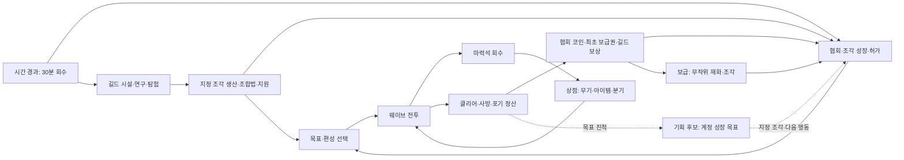

# 서울 히어로 밸런스·콘텐츠 디자인 검토

작성일: 2026-10-07 · 대상: Godot 4.7.2 프로젝트 · 기준 밸런스: 2026.09-gwanghwamun-depth1-v4

이 문서는 작성 당시의 검토 기록이다. 2026-10-12에 구현한 `2026.10-gwanghwamun-balance-v1`의 현행 수치·저장 규칙·플레이 확인 항목은 [통합 밸런스 기준](../../docs/BALANCE.md)을 따른다.

## 1. 결론과 판단 범위

현재 게임은 한 판의 전투·상점·분기 선택과 영구 성장·길드 운영을 연결할 기본 시스템을 갖췄다. 지금 필요한 작업은 재화나 콘텐츠 수를 먼저 늘리는 것보다 **구매한 효과를 실제 전투에 연결하고, 30~60분 연속 플레이에서 다음 성장을 선택할 수 있게 만드는 것**이다.

사용자가 선택한 방향은 **현재 구조를 개선하면서 한 번에 30~60분 이상 즐기는 게임**이다. 따라서 초반 조각·시설 대기로 전투의 다음 목표가 끊기는 문제, 심도 20 이후 접근, 무기·분기의 역할 차이, 결과 화면에서 다음 행동을 찾는 경험을 우선한다. 수개월 이상 확장하는 방향은 유지한다.

이 보고서와 독립 화면 시안을 작성했으며, **게임 코드·밸런스 데이터·저장·런타임 UI는 수정하지 않았다**. 자동 테스트·전체 빌드·수동 플레이 QA·사용자 저장 및 실제 전적 조회도 하지 않았다. 신규 화면 시안은 별도 승인 전까지 게임에 연결하지 않는다.

판단은 다음 네 종류로 구분한다.

| 표기 | 의미 |
|---|---|
| **현행 사실** | 저장소의 데이터와 실제 Godot 실행 연결에서 확인한 내용 |
| **정적 계산** | 명시한 입력·수식으로 산출한 수치. 실제 판 수·성공률·체감 DPS를 뜻하지 않음 |
| **플레이 가설** | 사용자 플레이 기록으로 확인해야 하는 체감·난이도·선호에 관한 추정 |
| **기획 후보** | 이 보고서에서 제안하는 후속 변경. 수치·보상·새 행동을 승인하거나 구현한 상태가 아님 |

경제의 기존 합의는 유지한다. 마력석은 출동 전용, 협회 코인은 전투 영구 성장, 조각 성장은 조각과 협회 코인을 함께 소비하며, 반복·사망 보상은 최초 완료보다 적고 출동 포기는 무보상이다. 아래 지정 조각 목표 보상과 콘텐츠 변곡점은 **이 원칙 위에 추가하는 미승인 후보**다.

## 2. 현재 구조와 콘텐츠

### 2.1 실제 소유·연결 구조

- 공용 콘텐츠·밸런스 원본은 src/data다. exporter가 Godot content.json으로 반영한다. 보존 웹판의 규칙을 Godot 구현 상태로 오인하면 안 된다.
- Godot의 state는 출동 상태, systems는 전투·상점·메타·길드 규칙, core는 실행과 연결, ui/presentation은 화면·원화·연출을 소유한다.
- 영구 profile과 출동 checkpoint는 별개이며 v4다. 계정 최초 완료와 정산 출동 ID, 미수령 보상, 진행 중 길드 작업을 관리한다.
- Android APK·계정 연동·실기기 QA는 아직 별도 작업이다. 이 보고서가 배포 준비 완료를 뜻하지 않는다.

근거: [Godot README](C:/Users/geniu/Documents/GitHub/Seoul-Hero/godot/README.md:57), [exporter](C:/Users/geniu/Documents/GitHub/Seoul-Hero/scripts/export-godot-content.mjs:124), [경제 연결 문서](C:/Users/geniu/Documents/GitHub/Seoul-Hero/godot/docs/ECONOMY.md:1).

### 2.2 콘텐츠 목록

| 분류 | 현재 수량·구성 | 디자인상의 의미 |
|---|---|---|
| 각성자 | 4명: 송진우·강태훈·박도준·윤하린, 새 게임에서 전원 해금 | 해금보다 선택 이유와 운용 차이가 중요 |
| 전투 무기 | 7종: 마력검·수호 표창·관통 사격·연쇄 번개·마력 폭격·마력탄·마력 샷건 | 각 무기 Lv.10, Lv.5에서 A/B 선택 |
| 설치물 | 3종: 자동 포탑·마력 지뢰·마력장 발생기 | 일반 무기 슬롯 사용. 포탑만 협회 허가 필요 |
| 무기 분기 | 10종×2 = 20분기 | 실제 효과 누락과 최종 구매 효용을 먼저 수정 |
| 아이템 | 55종: 일반 18·고급 18·희귀 9·영웅 5·전설 5 | 고유 조건 아이템 15종, 나머지 40종은 수치·복합 수치·설치/투사체 지원 중심 |
| 적 | 19종: 일반 적 17·보스 2 | 같은 행동 처리기를 공유하는 변종의 역할 구분 필요 |
| 맵·웨이브 | 광화문 광장 1개, 20웨이브, 마지막 보스 | 장기 플레이에서 배경·목표 변화가 제한적 |
| 단군의 축복 | 7종, 조각 성장 5단계 | 선택 화면은 있으나 초반 확정 체험 경로가 약함 |
| 주간 규칙 | 7종, 일주일 동안 한 규칙 적용 | 위험과 이득을 함께 주지만 세션마다 바뀌는 콘텐츠는 아님 |
| 전투 조합법 | 3종: 조율 마력핵·헌터 방호 코트·자력 회수기 | 길드 설계도·연구와 출동 아이템 선택 연결 |
| 길드 | 시설 8·연구 11·직원 후보 20·탐험 3 | 운영 깊이는 충분하나 처음부터 모두 설명하면 과부하 |
| 협회 | 무제한 스탯 19종·해금 3종 | 같은 코인의 경쟁 소비처를 이해시키는 안내 필요 |

근거: [각성자](C:/Users/geniu/Documents/GitHub/Seoul-Hero/src/data/characters/index.ts:16), [무기](C:/Users/geniu/Documents/GitHub/Seoul-Hero/src/data/weapons/index.ts:6), [설치물](C:/Users/geniu/Documents/GitHub/Seoul-Hero/src/data/weapons/structures.ts:5), [아이템](C:/Users/geniu/Documents/GitHub/Seoul-Hero/src/data/items/index.ts:75), [적](C:/Users/geniu/Documents/GitHub/Seoul-Hero/src/data/enemies/index.ts:5), [주간 규칙·축복](C:/Users/geniu/Documents/GitHub/Seoul-Hero/src/data/weeklyGate.ts:24), [길드](C:/Users/geniu/Documents/GitHub/Seoul-Hero/src/data/guildManagement.ts:41).

### 2.3 플레이 루프

**현행 사실:** 전투 안의 성장과 길드의 시간 성장은 존재한다. **플레이 가설:** 실패가 반복되거나 첫 클리어 재원이 소진되면, 다음 전투 대신 회수·생산을 기다리는 행동이 유리해 보일 수 있다. 이를 해결하는 후보는 반복 코인을 무조건 늘리는 대신, 지정 성장 목표와 심도 콘텐츠 변화로 전투의 목적을 이어 주는 것이다.

## 3. 우선 수정·확인할 항목

규모는 S=기존 연결 한 곳 중심, M=관련 규칙·표시·저장 등 여러 연결, L=새 데이터 모델·여러 화면·저장 이관 포함으로 표시한다. 이는 일정 약속이 아니다. 완료 기준은 후속 구현의 기준이며 이번에 실행한 테스트가 아니다.

### 3.1 P0: 밸런스 논의 전에 실제 효과를 일치시킬 6건

| 항목·근거 | 영향 | 권장 변경 | 규모 | 완료 기준 |
|---|---|---|---|---|
| **P0-1 최종 무기 강화에서 1타 피해 감소.** progression.ts:8 midpoint·:19 softenFinal, stats.gd:35 | 샷건을 제외한 18분기에서 Lv.9보다 Lv.10의 1타 피해가 낮다. 69마력석 최종 구매가 손해처럼 보일 위험 | 기존 목표인 과거 최종 1타 피해의 약 85%는 유지하되, 중간 단계 보간과 최종 단계가 역행하지 않게 설계. 20분기를 같은 기준으로 점검 | M | 각 분기의 Lv.1~10 구매에서 핵심 역할 지표가 감소하지 않음. 의도한 피해/범위 교환은 설명에 명시 |
| **P0-2 연속 폭격의 반복 횟수 미실행.** branches.ts:36, attacks.gd:76 | 마력 폭격 B의 repeatCount 2→3이 예약 공격 수로 연결되지 않음 | 투하 개수와 반복 횟수를 구분해 예약. 반복 간격·웨이브 정리·공유 흡혈 예산을 함께 유지 | M | B 분기의 실제 예약·발동 횟수가 데이터와 일치하며 다음 웨이브로 남지 않음 |
| **P0-3 중량 표창 범위 증가 미적용.** branches.ts:24, stats.gd:40, attacks.gd:178 | areaMultiplier가 투사체 반경에는 반영되지만 궤도 표창 충돌은 고정 반경 29 사용 | 수호 표창의 표시·적중 범위가 같은 유효 범위를 사용하도록 연결. 새 전용 스탯은 추가하지 않음 | S~M | 중량 표창의 범위·공격 범위 스탯 변화가 실제 적중 경계에 반영 |
| **P0-4 설치물 수명·지속시간 효용 누락.** structures.ts:6~8, attacks.gd:221 | age를 늘리지만 duration을 수명 제거에 사용하지 않음. 포탑 12초·지뢰 20초·마력장 7초의 데이터 의미와 실행이 다르며 마력장 DURATION 성장이 연결되지 않음 | 기존 duration의 의미를 확정한 뒤 capability 기준 수명 제거·설치 한도·재설치를 연결. 설치 주기와 공격 주기를 구분 | M | 확정한 수명 의미가 실행과 일치하고 재설치되며, 지속시간이 허용된 무기에만 반영 |
| **P0-5 80코인 리롤 허가의 실제 효용 불명확.** meta/index.ts:38, meta_rules.gd:69, shop.gd:118 | 해금 기록을 쓰지만 현행 상점 리롤은 누구나 가능. 설명은 퇴역한 강화 후보 재추첨을 언급 | 기존 상점의 유료 리롤은 유지하고, 허가는 출동당 상점 한 상품군 1회 무료 리롤로 재정의하는 후보. 첫 1회 표시·소모·체크포인트 필요. 효과 결정 전 구매 권유 금지 | M | 구매 전후 실제 기능 차이가 있으며 80코인·설명·무료 사용 횟수가 일치. 재접속으로 횟수 복구되지 않음 |
| **P0-6 심도 21 이후 일반 화면 접근 불가.** gate_screen.gd:72, meta_rules.gd:259 | 다음 심도는 계속 해금되지만 UI가 1~20에 고정. 최초 보급권과 새로운 도전 경로 중단 | 20심도 단위 페이지와 최고 해금 심도 이동, 계정 최초 보상 여부 표시. 숫자만 높은 심도 개방과 콘텐츠 변화를 구분 | M | 심도 20 완료 후 21 선택 가능. 잠금·최초 완료·반복 보상 상태가 계정 기록과 일치 |

근거 파일: [진행 보간](C:/Users/geniu/Documents/GitHub/Seoul-Hero/src/data/weapons/progression.ts:8), [분기](C:/Users/geniu/Documents/GitHub/Seoul-Hero/src/data/weapons/branches.ts:24), [공격 실행](C:/Users/geniu/Documents/GitHub/Seoul-Hero/godot/scripts/systems/attacks.gd:76), [스탯](C:/Users/geniu/Documents/GitHub/Seoul-Hero/godot/scripts/systems/stats.gd:35), [상점](C:/Users/geniu/Documents/GitHub/Seoul-Hero/godot/scripts/systems/shop.gd:118), [심도 화면](C:/Users/geniu/Documents/GitHub/Seoul-Hero/godot/scripts/ui/gate_screen.gd:72).

P0-5의 무료 리롤 효과는 **미승인 기획 후보**다. 실제 미사용 구매 문제는 현행 사실이지만, 효과를 바꾸는 결정까지 이미 승인된 것은 아니다.

### 3.2 P1: 성장 속도·선택·전투 구성

| 항목·근거 | 영향·가설 | 권장 후보 | 규모·완료 기준 |
|---|---|---|---|
| **지정 조각의 초기 확정 경로 부족.** metaFacilities.ts:2, guildManagement.ts:160, meta_rules.gd:116 | 초반 보급 조각이 계열·대상으로 분산. 축복 체험이 생산실 Lv.5 뒤로 밀림 | 첫 완료 지정 무기 12조각·심도 3 선택 축복 18조각 목표. 기존 코인 결제 유지 | L. 계정 1회 목표 지급·선택·저장·성장 결과 일치 |
| **반복 실패의 다음 성장 단절.** economy.ts:68, meta_rules.gd:260 | 10웨이브 사망 3회가 6코인이라 일반 강화에도 멀다 | 완료 웨이브·처치·빌드 체험 목표를 누적. 사망 정산 코인은 유지 | M~L. 실패 결과에서도 진척과 다음 행동이 보이며 포기 보상 규칙을 침해하지 않음 |
| **협회 작은 증가량의 반올림 계단.** stats.gd:35, run.gd:95 | 어떤 무기는 첫 +0.3%p가 1타를 바꾸지 않음. 같은 투자 체감이 무기마다 다름 | 내부 피해 소수 유지 후보와 표시 정밀도를 분리. 코인 가격·증가량을 먼저 크게 올리지 않음 | M. 작은 보너스가 내부 계산에 남고, 표시 반올림으로 잘못된 기대를 만들지 않음 |
| **같은 코인의 경쟁 소비처 안내 부족.** economy.ts:10, guildManagement.ts:163 | 협회 19종·조각·아이템·추첨 중 왜 이것을 사는지 불명확 | 출동 빌드와 연결되는 강화 후보·비용·현재 확보 방법 비교 | M. 스탯 범용성·조각 대상 제한·시설 조건을 읽고 선택 가능 |
| **패널티의 실제 적용 조건 차이.** stats.gd:14, items/index.ts:125 | 순정 방어·치명·재생 0에서는 음수 보정이 0 하한에 막혀 일부 대가가 발생하지 않음. 스탯 적용 태그가 없는 무기도 있음 | 순정/성장 계정과 적용 무기를 나눠 손익 확인. 의도된 시너지인지 결정한 뒤 설명·대가 후보를 조정 | M. 손해가 실제 발생하는 조건을 설명하며 모든 계정에 동일한 대가라고 가정하지 않음 |
| **각성자의 기본 수치 차이에 비해 행동 차이 약함.** characters/index.ts:16 | 4명 전원 해금인데 동일 무기로 플레이하면 경험이 비슷할 가능성 | 기준 송진우는 유지하고 박도준·윤하린의 한 줄 특성을 조건·행동으로 차별화 | M. 각성자별 유리한 선택과 대가를 한 문장으로 설명 가능 |
| **같은 AI의 변종이 함께 등장.** enemies/index.ts:8, enemy_brain.gd:23 | 마탄 사수/신호등 나방, 치유 꽃해파리/유리 해파리 등의 위협 구분 약함 | 능력 복제보다 등장 구간·거리·예고·우선 제거 이유 차별화 | M. 실루엣뿐 아니라 회피·접근·우선 제거 행동이 다름 |
| **적 로스터가 웨이브마다 누적.** maps/index.ts:24 | 후반에는 너무 많은 역할이 동시에 섞여 웨이브 이름과 체험이 흐려질 수 있음 | 20웨이브를 소개·대응·혼합·정예·보스 장면으로 재편 | M. 웨이브마다 핵심 위협 1~2개와 대응 빌드가 설명됨 |
| **소환 상한의 뜻 확인 필요.** enemyConfig.ts:3, enemy_brain.gd:146 | 부모 평생 소환 6회 상한이어서 보스 소환 패턴이 이후 빈 행동이 될 수 있음 | 동시 생존 자식 상한과 평생 상한 중 의도 결정. 재소환 시 보상·최대 개체도 검토 | M. 보스 장기전에서도 의도한 패턴을 유지하며 자식 무한 수급 방지 |
| **초기 직원 교육과 근무 성장의 효용 겹침.** guildManagement.ts:161 | Lv.1은 무료 근무 2시간과 유료 교육 2시간 모두 Lv.2. 초보가 손해 선택 가능 | Lv.1 직원의 자연 성장 안내를 앞에 배치. 상위 교육의 단축 효용 표시 | S~M. 교육 결과와 자연 성장 예상 시간을 비교 가능 |
| **첫 완료 보너스 연구의 유효 기간 짧음.** guild_support.gd:13 | 현행 20개 첫 완료를 소진하면 연구가 새 맵/심도 전까지 효용 없음 | 심도 접근부터 수정하고 아직 남은 최초 목표에 대한 효과를 표시 | S~M. 보너스를 받을 수 있는 미완료 목표가 보임 |

소환·초반 교육·체감 선택은 **설계 확인 또는 플레이 가설**이다. 확정 전투 버그로 묶지 않는다. 근거: [적 AI](C:/Users/geniu/Documents/GitHub/Seoul-Hero/godot/scripts/systems/enemy_brain.gd:23), [길드 직원 수치](C:/Users/geniu/Documents/GitHub/Seoul-Hero/src/data/guildManagement.ts:161), [메타 성장](C:/Users/geniu/Documents/GitHub/Seoul-Hero/godot/scripts/systems/meta_rules.gd:76).

## 4. 경제와 첫 60분·첫 주·첫 달

### 4.1 계산 가정

- 길드 업그레이드·직원 보너스·생산·탐험·보급 운은 제외한 순정 값이다.
- 첫 세션은 3회 결과의 유형을 비교한다. **60분에 반드시 3회 완료 가능하다는 뜻은 아니다.**
- 주·월 비교는 하루 3회 완료 중 첫 20일에 매일 새 심도 1개+심도 1 반복 2개, 이후에는 심도 1 반복 3개라는 입력을 사용한다.
- 회수는 12시간 상한에 맞춰 하루 두 번 받는 96협회 코인과, 하루 한 번 받는 48코인을 비교한다.
- 실제 3회 완료는 실력·실패·보스 처치·상점 시간에 좌우된다. 하루 30~60분의 플레이 목표와 이 계산상의 완료 수를 같은 사실로 취급하지 않는다.
- 심도 21 선택 문제를 아직 수정하지 않은 **현행 20개 접근 제한**을 월 계산에 반영한다.

웨이브 1~19 정해진 전투 시간 합계는 **13분 55초**다. 데이터상 마지막 70초까지 더하면 15분 5초지만, **보스의 70초는 처치 시간 제한이나 강제 완료 시간이 아니다.** 마지막 웨이브는 보스 처치로 끝나므로 실제 길이는 별도 확인해야 한다. 각 웨이브 뒤 상점·분기 선택과 postWave 전환도 세션에 추가된다.

근거: [광화문 웨이브](C:/Users/geniu/Documents/GitHub/Seoul-Hero/src/data/maps/index.ts:54), [보스 완료 조건](C:/Users/geniu/Documents/GitHub/Seoul-Hero/godot/scripts/core/simulation.gd:58).

### 4.2 협회 코인 비교

| 비교 시나리오 | 전투 코인 | 기본 회수 | 합계 | 읽어야 할 의미 |
|---|---:|---:|---:|---|
| 첫 세션: 심도 1~3 최초 완료 3회 | 330 | 1시간분 4 | 334 | 초기 선택할 자금은 있으나 지정 조각이 부족 |
| 첫 세션: 심도 1 반복 완료 3회 | 60 | 4 | 64 | 일반 강화 한 번 또는 조각 성장 결제에 가까움 |
| 첫 세션: 심도 1에서 완료 10웨이브 후 사망 3회 | 6 | 4 | 10 | 적극적으로 플레이해도 첫 강화까지 멂 |
| 7일: 새 심도 1~7+반복 14회 | 910+280 | 672 / 336 | **1,862 / 1,526** | 앞 값 하루 회수 2회, 뒤 값 1회 |
| 30일: 새 심도 1~20+반복 70회 | 3,900+1,400 | 2,880 / 1,440 | **8,180 / 6,740** | 총 90완료라는 가정. 21일부터 새 최초 보상이 없음 |

위 표는 코인 유입 총량이며 그동안의 소비를 차감하지 않았다. 새 지정 조각 목표 후보도 포함하지 않았다. 실제 클리어율이나 유지율 통계가 아니다.

### 4.3 비용·시간의 경쟁

현재 단계 n의 일반 가격은 50+10n, 주요 가격은 100+20n이다. n회 구매의 총 비용은 각각 **50n+5n(n−1)**, **100n+10n(n−1)**이다. 전체 19종은 일반 12·주요 7종이다.

| 목표 | 현행 비용·효과 | 순정 시간 기준 |
|---|---|---|
| 일반 협회 첫 구매 | 50코인 | 기본 회수만 12시간 30분 |
| 주요 협회 첫 구매 | 100코인 | 기본 회수만 25시간 |
| 협회 19종 모두 1회 | 1,300코인 | 회수만 325시간 |
| 협회 19종 모두 10회 | 24,700코인 | 회수만 6,175시간 |
| 캐릭터 성장 1회 | 지정 조각 20+50코인, 기본 체력의 +3% | 지정 조각 순정 생산 20시간 |
| 무기 성장 1회 | 지정 조각 12+50코인, 대상 피해 +4% | 무기 생산 해금 후 12시간 |
| 축복 해금 1회 | 지정 조각 18+50코인, 해당 축복 Lv.1 | 축복 생산 해금 후 18시간 |
| 캐릭터 5단계 누적 | 300조각+1,000코인 | 순정 조각 생산 300시간 |
| 무기 5단계 누적 | 172조각+1,000코인 | 순정 조각 생산 172시간 |
| 축복 5단계 누적 | 248조각+1,000코인 | 순정 조각 생산 248시간 |
| 아이템 영구 강화 5단계 | 1,200코인, 해당 아이템의 양수 수치 +25% | 장비공방·기존 작업 시간 필요 |
| 캐릭터 옵션 추첨 | 매회 250코인 | 각성분석실 필요. 원하는 옵션 보장 없음 |

생산은 기본 1조각/시간이며 직원·연구가 배율을 올린다. 시설 레벨 자체는 조각 계열을 Lv.1/3/5에서 여는 역할이다. 시간 표는 건설·연구 대기와 상한으로 버린 시간을 제외한 생산 시간이다. 하루 한 번 수령하고 12시간 상한을 유지하면 실제 달력 날짜는 더 길어진다.

**정적 비교:** 무기 Lv.1 영구 성장은 50코인+12조각으로 그 무기 +4%다. 협회 원거리 피해 +4%p는 10회·950코인이고 적용 범위가 더 넓다. 두 선택은 비용 차이만으로 비교하지 않고 **대상 제한·조각 확보 시간·범용성**을 함께 안내해야 한다.

**플레이 가설:** 현행 협회 피해의 첫 구매는 무기에 따라 1타가 즉시 바뀌거나 그대로다. 예를 들어 송진우 기본 마력탄은 22×0.85×1.05=19.635→20이며 +0.3%p 뒤에도 20이다. 반대로 마력검은 42×0.85×1.05=37.485→37에서 첫 구매 뒤 38이 된다. 작은 증가량의 효용이 계단식으로 보이는 문제이지 모든 구매가 무효라는 뜻은 아니다.

### 4.4 보급·생산·길드의 역할

보급 가중 선택과 천장을 가능한 순서별로 정적 계산하면 다음과 같다.

- 자연 추첨에서 조각이 하나라도 포함될 상자 확률: 약 **8%**.
- 천장 0에서 시작한 20상자: 전 계열·전 대상 조각 합계 평균 **약 3.5개**.
- 그중 특정 축복 한 종류: 평균 **약 0.17개**. 축복은 7종이며 첫 해금에는 18개가 필요하다.
- 따라서 보급은 희귀 보너스이며, **특정 초기 축복의 주 성장 경로로 보기 어렵다**. 10상자 천장은 어떤 조각이든 보장하며 선택한 대상까지 보장하지 않는다.

이 계산은 코드의 선택 순서·수량·천장을 따른 값으로 플레이 실적이 아니다. 보급권 재등장으로 생기는 추가 개봉은 제외했다. 근거: [보급 데이터](C:/Users/geniu/Documents/GitHub/Seoul-Hero/src/data/economy.ts:80), [보급 실행](C:/Users/geniu/Documents/GitHub/Seoul-Hero/godot/scripts/systems/meta_rules.gd:120).

길드의 첫 선택은 유효하다. 운영실 1개로 3칸을 시작하므로 생산·탐험·연구 중 둘을 먼저 지을 수 있다. 운영실 Lv.2가 요구하는 건축 부품 12개와 시작 부품 12개를 다른 건설이 함께 소비하므로, 무엇을 먼저 짓느냐에 따라 첫 증축까지 기다리는 시간이 달라진다. 이를 숨기지 않고 **생산 우선: 지정 성장 / 탐험 우선: 재료·설계도 / 연구 우선: 지원 효율**로 안내하는 편이 좋다.

탐험의 30분·2시간·8시간은 단순히 긴 쪽이 모두 효율적이지 않다. 순정 시간당 기준으로 30분 순찰은 자재 30·건축 12·가속권 2, 2시간 조사는 자재 30·전자 8·연구 7.5, 8시간 탐사는 자재 22.5·건축 8·가속권 약 0.6이다. 짧은 탐험은 자주 수령하는 세션에 유리하고 길드 코인 비용은 더 자주 낸다. 오랜 부재의 편의와 총량을 구분해 설명한다.

### 4.5 초기 확정 성장 목표 후보

| 목표 후보 | 조건·선택 | 보상·소비 | 중복·저장 범위 |
|---|---|---|---|
| **첫 무기 성장** | 계정 최초의 정상 클리어 후 현재 해금된 시작 가능 전투 무기 7종 중 하나 선택 | 지정 무기 조각 12개. 성장 시 현행 50코인 소비 | 계정 전체 1회. 캐릭터·맵을 바꿔 재지급하지 않음 |
| **첫 축복 선택** | 광화문 심도 3 최초 완료 후 축복 7종 중 하나 선택 | 지정 축복 조각 18개. 해금·Lv.1 성장 시 현행 50코인 소비 | 계정 전체 1회. 같은 심도 반복·다른 캐릭터 클리어로 추가 지급하지 않음 |

두 보상은 클리어 표의 코인·보급권을 변경하거나 무작위 보급을 대체하지 않는다. 새로하기·포기·사망으로 달성되지 않는다. 이미 심도 3까지 완료한 계정은 후속 기능 도입 시 이 두 목표를 한 번 수령 가능하게 하는 후보이며, 기존 성장·재화를 초기화하지 않는다. 선택 전에는 미수령 목표로 남고 선택 확정 후 지정 조각을 지급한다. 수령 기록과 지급을 함께 저장하고, 저장 실패·재접속·연출 재생으로 중복 지급하지 않아야 한다.

현재 profile v4에 이 목표 수령 상태는 없다. **실제 도입 시** 계정 단위 목표 정의·수령/선택 기록·저장 이관이 필요하다. 계정 최초 보상 기록과 캐릭터별 진행 기록을 혼용하지 않는다. 미래 버전 보호도 유지한다.

코인 경쟁은 남긴다. 첫 완료 100코인을 포탑 허가 100에 전부 쓸지, 지정 무기 성장 50+일반 협회 강화 50에 쓸지 선택한다. 심도 1~3 최초 완료 330코인 중 두 성장에 100을 쓰면 230이 남는다. 무료 리롤 허가 후보 80·포탑 100·흡혈 회로 120을 모두 살 수는 없으며, 체험한 빌드와 연결되는 선택이 생긴다.

## 5. 무기·분기와 아이템

### 5.1 10무기의 역할을 먼저 명확히 한다

아래는 현재 행동·분기를 근거로 정리한 역할과 수정 후 확인할 가설이다. 추천 순위나 실측 최강 무기 표가 아니다.

**현행 가격:** 새 전투 무기 36·설치물 44마력석, Lv.2~10 강화 합계 383마력석이다. 아이템 리롤은 5+n, 무기 리롤은 6+2n이며 두 누적 횟수와 잠금을 독립적으로 관리한다. 여기서 n은 해당 상품군의 기존 리롤 횟수다. 근거: [상점 수치](C:/Users/geniu/Documents/GitHub/Seoul-Hero/src/data/shopConfig.ts:6).

| 무기 | 기본 역할 | A / B의 선택 이유 | 우선 확인·개선 |
|---|---|---|---|
| 마력검 | 가까운 적 무리를 방향·거리로 정리 | 광역 검격: 넓은 부채꼴 / 연속 검격: 좁은 범위 반복 | 단일 적과 군집 차이, 최종 단계 피해·범위 교환 |
| 수호 표창 | 몸 주변 접근 차단 | 표창 군무: 개수 / 중량 표창: 개수 적지만 큰 적중 범위 | 중량 범위 적용과 궤도 실제 접촉률 |
| 관통 사격 | 길게 늘어선 적 처리 | 관통 포격: 한 발·많은 관통 / 산개 사격: 여러 방향 | 실제 대열 형성 여부, 관통 수가 피해 대상 수로 쓰이는지 |
| 연쇄 번개 | 가까운 적 사이 분산 처리 | 연쇄 폭풍: 많은 서로 다른 대상 / 집중 뇌격: 적은 대상·강한 1타 | 보스 한 마리에서 연쇄 개수를 DPS로 곱하지 않기 |
| 마력 폭격 | 예고 지점의 군집 처리 | 대형 폭발: 큰 범위 / 연속 폭격: 작은 범위 반복 | B 반복 실행·적 이동으로 인한 빗나감 |
| 마력탄 | 안정적인 원거리 기본 무기 | 다중 난사: 넓은 탄 / 초관통: 한 발 대열 | 연쇄·관통 사격과 역할 겹침, 낮은 영구 성장 반올림 |
| 마력 샷건 | 가까이 붙어 여러 탄을 맞히는 위험형 | 확산 제압: 넓은 산탄 / 집중 산탄: 좁고 강한 관통 | 모든 탄 명중 가정을 실제 단일 보스 DPS로 오인하지 않기 |
| 자동 포탑 | 설치 위치에서 지속 사격 | 다중 발사: 탄 수 / 고속 작동: 주기 | 수명·개수·위치와 플레이어 이동 선택 |
| 마력 지뢰 | 설치 지점에 접근한 적에 반응해 폭발 | 광역 강화: 반경 / 고속 작동: 설치·폭발 흐름 | 설치 주기와 발동 주기를 구분, 놓친 지뢰의 수명 |
| 마력장 발생기 | 고정 공간을 지속 장악 | 광역 강화: 영역 / 고속 작동: 피해 주기 | 수명·지속시간, 플레이어가 그 주변에서 싸울 이유 |

무기 6슬롯을 유지한다. 분기는 Lv.5에서 한 번 선택하고 그 출동 동안 고정하는 규칙을 유지한다. 별도 설치물 전용 플레이어 스탯이나 새 무기 슬롯을 만들지 않는다.

### 5.2 Lv.9→10 정적 비교: 타격 피해와 모든 개수 적중 지표를 구분

기준은 송진우의 고유 피해 +5%, 전역 무기 피해 배율 0.85, 다른 아이템·축복·영구 성장 없음, Godot 공통 단계와 분기 단계 병합 및 정수 반올림이다. 단위는 **타격 피해/초당 발동 지표**이며 실제 전투 DPS가 아니다. 마지막 강화 가격은 69마력석이다.

“타격×개수/쿨”은 모든 명시 개수가 유효하게 맞는다는 수학적 지표다. 연쇄는 서로 다른 대상, 산탄은 퍼진 탄, 궤도 표창은 실제 접촉 조건이 있으므로 같은 보스에게 모두 적용된다고 가정하면 안 된다. 범위 안의 적 수·적 이동·빗나감·설치 밀도·관통의 추가 적 수는 이 표에 넣지 않았다.

| 무기·분기 | 1타 피해 9→10 | 주기(초) 9→10 | 개수·반복 9→10 | 타격×개수/쿨 변화 |
|---|---:|---:|---|---:|
| 마력검 A 광역 검격 | 84→71 | 0.79→0.76 | 1 | 약 −12% |
| 마력검 B 연속 검격 | 43→36 | 0.67→0.64 | 반복 2 | 약 −12% |
| 수호 표창 A 표창 군무 | 27→23 | 0.31→0.30 | 5→6 | 약 +6% |
| 수호 표창 B 중량 표창 | 52→44 | 0.32→0.32 | 3 | 약 −15% |
| 관통 사격 A 관통 포격 | 70→59 | 0.82→0.82 | 탄 1 | 약 −16% |
| 관통 사격 B 산개 사격 | 45→38 | 0.84→0.84 | 탄 3 | 약 −16% |
| 연쇄 번개 A 연쇄 폭풍 | 37→32 | 1.10→1.05 | 서로 다른 대상 6→7 | 약 +6% |
| 연쇄 번개 B 집중 뇌격 | 96→82 | 1.005→0.96 | 서로 다른 대상 2 | 약 −11% |
| 마력 폭격 A 대형 폭발 | 118→100 | 1.70→1.60 | 폭발 1 | 약 −10% |
| 마력 폭격 B 연속 폭격 | 45→38 | 1.71→1.62 | 현행 실행 폭발 1 | 약 −11% |
| 마력탄 A 다중 마력 난사 | 36→30 | 0.58→0.56 | 탄 3 | 약 −14% |
| 마력탄 B 초관통 마력탄 | 64→55 | 0.58→0.58 | 탄 1 | 약 −14% |
| 자동 포탑 A 다중 발사 | 24→20 | 0.82→0.82 | 탄 2 | 약 −17% |
| 자동 포탑 B 고속 작동 | 24→20 | 0.492→0.492 | 탄 1 | 약 −17% |
| 마력 지뢰 A 광역 강화 | 100→85 | 2.10→2.10 | 폭발 1 | 약 −15% |
| 마력 지뢰 B 고속 작동 | 100→85 | 1.26→1.26 | 폭발 1 | 약 −15% |
| 마력장 A 광역 강화 | 18→15 | 0.85→0.85 | 펄스 1 | 약 −17% |
| 마력장 B 고속 작동 | 18→15 | 0.51→0.51 | 펄스 1 | 약 −17% |
| 마력 샷건 A 확산 제압 | 11→11 | 1.30→1.20 | 탄 8→9 | 약 +22% |
| 마력 샷건 B 집중 산탄 | 16→18 | 1.24→1.24 | 탄 5 | 약 +13% |

**확정 사실:** 샷건을 제외한 18분기의 1타 피해는 낮아진다. **해석 주의:** 표창 A·번개 A는 개수까지 맞으면 합산 지표가 높아진다. 번개 A는 단일 대상 지표로 보면 약 −9%다. 검·폭격 등은 Lv.10의 범위 증가로 더 많은 적에게 맞을 수 있어, 표의 감소를 실제 군집 DPS 전체 감소로 단정하지 않는다.

원인은 최종 피해 ×0.85와 보간의 결합이다. midpoint의 이전 단계에 damage가 없으면 다음 damage가 Lv.9에 바로 들어가고, Lv.10은 그보다 작은 값을 적용한다. 기존 “과거 최종 1타 피해의 약 85%” 목표와 별도 전역 피해 배율 0.85를 혼동하지 않고 수정한다.

근거: [무기 보간](C:/Users/geniu/Documents/GitHub/Seoul-Hero/src/data/weapons/progression.ts:8), [무기 분기](C:/Users/geniu/Documents/GitHub/Seoul-Hero/src/data/weapons/branches.ts:3), [스탯 병합·반올림](C:/Users/geniu/Documents/GitHub/Seoul-Hero/godot/scripts/systems/stats.gd:22), [개수별 공격](C:/Users/geniu/Documents/GitHub/Seoul-Hero/godot/scripts/systems/attacks.gd:42).

### 5.3 55아이템의 역할 분류

중복 집계를 피하기 위해 주 역할 기준으로 나누었다. 기본 수치 재료가 있어도 모든 아이템에 복잡한 발동을 붙일 필요는 없다.

| 주 분류 | 수량 | 포함 아이템 |
|---|---:|---|
| 기본 단일 능력치·경제 | 19 | 에너지 드링크·삼각김밥·러닝화·헌터 조준경·행운 부적·방탄 조끼·재생 붕대·튼튼한 지갑·휴대용 자석·작업 장갑·레이저 사이트·마력 렌즈·압축 스프링·디지털 타이머·광각 마력 렌즈·정밀 안경·예리한 숫돌·회피 우산·헌터 혈액팩 |
| 복합 수치·복합 대가 | 10 | 반동 안정 팔찌·응급 회복 앰플·전술 발목 보호대·자력 회수기·강화 전술 하네스·위상 축전기·이온 도체·휴대 차폐기·공명 프리즘·조율 마력핵 |
| 큰 이득과 명시적 대가 | 4 | 과충전 배터리·검술 교본·저주받은 마력석·헌터 방호 코트 |
| 설치·투사체·연쇄 기능 | 7 | 공구함·연쇄 도체·분광 렌즈·지뢰 보급함·흡혈 회로·지휘 코어·폭풍 심장 |
| 조건·트리거·생존 장치 | 15 | 정박 배지·관성 릴·흉터 인장·개문 승차권·종결 종·결투 나침반·지평 거울·새벽 보온병·전장 봉합기·보복 퓨즈·회수 여과기·배달 바퀴·초회 방패패·금고 장부·불사 성냥 |

우선 개선 대상과 후보는 다음과 같다. 전부 **수치 변경 전 사용자 선택·발동 확인이 필요한 기획 후보**다.

| 대상 | 현재 선택 문제·가설 | 개선 방향·화면 안내 |
|---|---|---|
| 압축 스프링·디지털 타이머 | 투사체 속도·지속시간이 실제 무기에 적용되는지 불명확 | 보유 무기 중 영향을 받는 이름을 표시. 해당 무기가 없을 때 정보만 표시하고 강제 제외하지 않음 |
| 이온 도체·광각 렌즈·공명 프리즘 | 원거리/범위가 실제 투사체·폭발에 어떻게 연결되는지 읽기 어려움 | “대열 관통 / 넓은 폭발 / 짧은 거리 다탄”처럼 역할을 설명. 비슷한 두 수치의 복제품 신규 추가 금지 |
| 연쇄 도체·분광 렌즈·폭풍 심장 | 한 발 추가와 서로 다른 대상 추가의 가치가 다름 | 보유 무기별 추가 개수의 뜻과 공격 속도·체력 대가를 함께 표시 |
| 정박 배지·관성 릴 | 정지·이동 빌드 전환을 유도할 수 있으나 발동 상태를 놓침 | 정지 시간/이동 조건의 현재 활성 표시. 행동으로 체험되는지 확인 |
| 관성 릴·개문 승차권·헌터 방호 코트의 대가 | 방어 −3·치명 −2%p·재생 −0.2가 순정 0 스탯에서는 실제 손해가 없음 | 양수 보정이 있을 때의 손해와 순정 계정의 효과를 비교. 의도된 시너지인지 확인하고 패널티를 숨기거나 버그로 단정하지 않음 |
| 금고 장부·튼튼한 지갑·저주받은 마력석 | 마력석을 쓰지 않는 조건과 많이 버는 조건의 경쟁 | 다음 웨이브 구매를 미루는 선택과 저주 위험을 명시. 마력석을 영구 재화로 보이게 하지 않음 |
| 헌터 방호 코트·재생 붕대·헌터 혈액팩 | 재생 감소와 다른 회복 경로의 대가를 판단하기 어려움 | 코트의 최대 체력 이득·재생 대가, 흡혈의 실제 허용 무기를 함께 설명 |
| 초회 방패패·불사 성냥·생환석 | 웨이브 1회 방패·출동 1회 생존·소모 부활을 혼동할 수 있음 | 세 가지 횟수 범위와 소모 시점을 구분. 자동 생존과 생환석을 한 이름으로 묶지 않음 |
| 조합법 결과 3종 | 길드에서 열었지만 출동 중 언제 조합할지 모를 수 있음 | 상점의 보유 재료→가능 조합→소비→결과를 보여 주고 “다음 목표”와 연결 |

기본 능력치 재료는 초반 이해와 조합에 필요하다. 삭제·대규모 전환보다 고유 기능과 대가가 큰 아이템의 읽기·효과 연결을 우선한다. 현재 아이템 영구 강화는 양수 수치만 증폭하고 패널티·특수 개수를 증폭하지 않는다. 따라서 “모든 효과 +25%”라는 일반 문구는 부정확하다.

**현행 사실:** 모든 스탯은 최소 0으로 계산하므로 위 음수 패널티는 해당 스탯의 양수 보정이 없는 동안 실질 손해가 0이다. 이온 도체의 공격 범위 −18%도 AREA가 없는 무기에 직접 적용되지 않는다. **설계 확인:** 이것을 빌드별로 대가를 피하는 의도적 선택으로 둘지, 해당 아이템이 대부분의 초기 계정에서 공짜 이득처럼 보이는지 사용자 플레이로 확인한다. 부호가 음수라는 이유만으로 동일한 불이익을 줬다고 평가하지 않는다.

근거: [아이템 정의](C:/Users/geniu/Documents/GitHub/Seoul-Hero/src/data/items/index.ts:75), [조건부 효과](C:/Users/geniu/Documents/GitHub/Seoul-Hero/godot/scripts/systems/item_effects.gd:5), [아이템 영구 강화 적용](C:/Users/geniu/Documents/GitHub/Seoul-Hero/godot/scripts/systems/guild_support.gd:36).

## 6. 각성자·적·웨이브의 콘텐츠 디자인

### 6.1 각성자 4명의 차별화 예시

새 캐릭터 추가보다 기존 네 선택의 이유를 강화한다. 본체 원화·SD 모션·20종 스탯을 유지하며 캐릭터별 공격 리그를 만들지 않는다. 아래 특성 변경은 **미승인 후보**이며 중복 버프로 그대로 추가하는 안이 아니다.

| 각성자 | 현행 사실 | 유지할 정체성·후보 |
|---|---|---|
| 송진우 | 중립 스탯, 모든 무기 피해 +5% | 순정 기준을 유지. 초보의 장비·분기 실험용 기준 캐릭터 |
| 강태훈 | 체력 +10·방어 +5·이속 −5%, 총기 피해 +15% | 총기·관통·집중 산탄 선택 이유를 명확히 안내. 현행 전문성이 있으므로 새 고유 효과를 급히 추가하지 않음 |
| 박도준 | 체력 +20·방어 +8·이속 −10%, 모든 무기 피해 +8% | 피해 특성 한 줄을 “웨이브 첫 직접 피해 경감”형 후보로 교체하여 위험 구역을 버티는 역할. 구체 감소율은 비교 후 결정 |
| 윤하린 | 이속 +12%·회피 +5%p·체력 −10, 모든 피해 +3% | 피해 특성 한 줄을 이동 중 공격 이득형 후보로 교체. 이동·회수 동선과 가까운/먼 적 선택을 연결 |

조건부 기능은 현행 아이템의 moving·firstShield 등과 책임을 공유하는 방향을 먼저 검토한다. 특정 캐릭터에 신규 전용 경험치·설치물 스탯·장비 슬롯을 부여하지 않는다. 장기 콘텐츠는 캐릭터 해금 수보다 **캐릭터×무기 분기×축복×아이템 행동**의 다른 조합을 목표로 한다.

### 6.2 유사 적의 역할 차별화 예시

| 실제 적 ID·이름 | 현재 공유 행동 | 차별화 후보·우선 제거 이유 |
|---|---|---|
| spitter 마탄 사수 / signalMoth 신호등 나방 | ranged: 같은 거리·예고·재사용 대기 규칙 | 사수는 먼 직선 압박, 나방은 짧은 거리의 명확한 점등·간헐 사격. 동시 투사체 수부터 크게 늘리지 않음 |
| mender 치유 꽃해파리 / glassJelly 유리 해파리 | support: 같은 반경·회복 주기 규칙 | 꽃해파리는 소수 강한 적을 살리는 후반 목표, 유리 해파리는 초반 회복 방해 소개. 반경·회복 크기·주기를 데이터로 구분 |
| sentinel 수문 방패령 / chainWarden 사슬 문지기 | defender: 같은 주기적 방어 규칙 | 방패령은 긴 방어/짧은 빈틈 학습, 문지기는 짧고 반복되는 방어와 느린 접근. 빈틈 표시를 실제 주기와 일치 |
| runner 질주체 / charger 돌진 뿔뱀 / ironBoar 철엄니 점액 | charge, 개별 charge 데이터 존재 | 질주체는 빠르지만 약함, 뿔뱀은 직선 위험, 철엄니는 긴 예고·느린 강한 충격. 현재 데이터를 먼저 읽히게 개선 |
| bulwark 철갑 점액 | tank, 주변 충격 공격 | 사슬 문지기와 다른 역할이다. 체력만 높은 방어 적으로 설명하지 않고 근접 충격 구역 통제 역할을 강조 |
| summoner 틈새 소환사 / splitter 분열 점액 | 주기 소환 / 사망 후 분열 | 살아 있는 우선 제거와 처치 뒤 정리의 행동 차이를 소개. 소환 자식 보상 배율·재소환·상한 유지 |

이 표는 새 원화 제작 목록이 아니다. 같은 단일 PNG·공용 모션 위에서 행동 데이터·편성·예고 가독성을 먼저 개선한다.

### 6.3 20웨이브 편성안

현행은 처음 등장한 일반 적을 이후 웨이브에 계속 누적한다. 후보는 각 웨이브마다 **주역 1개·보조 1~2개**, 위협 소개→대응 연습→조합의 흐름으로 바꾸는 것이다. 아래 편성은 명시한 일반 등장 풀만 사용하며 이전 풀을 자동 누적하지 않는다. 괄호 비율은 해당 웨이브 일반 적 가중치 후보이며 총 100이다. 기존 웨이브 시간·기본 spawnFor 곡선은 우선 유지하고 실제 난이도를 보고 밀도를 조정한다.

| 웨이브 | 편성 후보: 실제 이름(ID)·가중치 | 장면·확인할 선택 |
|---:|---|---|
| 1 | 균열체(crawler) 80 / 군집 벌레(swarm) 20 | 이동·자동 공격·마력석 회수 |
| 2 | 균열체 50 / 군집 벌레 50 | 첫 구매가 군집 정리에 반영되는지 |
| 3 | 균열체 60 / 질주체(runner) 40 | 돌진 예고 소개, 옆으로 피하기 |
| 4 | 동관 고리충(copperCrab) 60 / 질주체 40 | 직선 돌진과 꺾는 접근 구분 |
| 5 | 균열체 40 / 군집 벌레 30 / 질주체 30 | 기존 12초 거대 균열체 정예 유지, 범위/단일 우선 목표 |
| 6 | 마탄 사수(spitter) 40 / 균열체 60 | 적 탄 피하기와 접근·원거리 제거 |
| 7 | 마탄 사수 40 / 동관 고리충 40 / 군집 벌레 20 | 직선 탄과 접근 동선 혼합 |
| 8 | 철갑 점액(bulwark) 35 / 질주체 35 / 균열체 30 | 느린 충격 구역과 빠른 추격 사이 이동 |
| 9 | 철엄니 점액(ironBoar) 40 / 돌진 뿔뱀(charger) 30 / 군집 벌레 30 | 긴 예고와 짧은 예고 비교 |
| 10 | 철갑 점액 35 / 마탄 사수 35 / 균열체 30 | 기존 15초 장갑 철갑 점액 정예 유지, 첫 빌드 중간 시험 |
| 11 | 신호등 나방(signalMoth) 40 / 동관 고리충 40 / 군집 벌레 20 | 사격 타이밍·실루엣으로 원거리 변종 구분 |
| 12 | 유리 해파리(glassJelly) 25 / 철갑 점액 35 / 균열체 40 | 회복 적 우선 제거 소개 |
| 13 | 분열 점액(splitter) 40 / 질주체 30 / 군집 벌레 30 | 처치 뒤 남는 적을 범위 무기로 정리 |
| 14 | 폭렬 포자(bomber) 35 / 분열 점액 35 / 마탄 사수 30 | 자폭 구역에서 탈출, 회복과 공격 투자 비교 |
| 15 | 치유 꽃해파리(mender) 20 / 돌진 뿔뱀 40 / 철갑 점액 40 | 기존 18초 광폭·재생 질주체 정예 유지, 지원 적과 정예 우선 선택 |
| 16 | 사슬 문지기(chainWarden) 35 / 신호등 나방 35 / 군집 벌레 30 | 방어 빈틈 사이 사격 회피 |
| 17 | 틈새 소환사(summoner) 20 / 동관 고리충 40 / 마탄 사수 40 | 소환사가 살아 있으면 불어나는 군집 통제 |
| 18 | 수문 방패령(sentinel) 40 / 치유 꽃해파리 20 / 폭렬 포자 40 | 방어·회복을 기다릴지, 자폭 적을 먼저 처리할지 |
| 19 | 틈새 소환사 20 / 사슬 문지기 30 / 질주체 30 / 유리 해파리 20 | 전체를 무작정 쌓지 않는 종합 대응 시험 |
| 20 | 게이트 파수꾼(gatekeeper) 단독, 기존 보스 소환 자식 포함 | 돌진·광역·탄막·소환 패턴 시험. 일반 풀 추가는 하지 않음 |

심도 10의 그림자 잠복자(lurker)는 **11/14/17/19웨이브에서만** 일반 가중치 후보 15로 배치하고, 기존 편성의 나머지 비중을 85로 비례 조정하는 후보다. 모든 11~19웨이브에 자동 누적하면 새로운 그림자 위협이 다른 장면까지 덮을 수 있다. 심도 10 ARMORED, 심도 20의 BERSERK·REGENERATING 및 균열 여왕(riftQueen) 교체는 유지하되 중첩된 위협 가독성을 확인한다.

자동 조준 게임이므로 “지원 적을 클릭해 우선 공격”을 전제로 하지 않는다. **플레이어가 움직여 가까운 우선 목표를 바꾸고, 범위·관통·설치 위치를 활용할 수 있는가**가 완료 기준이다. 신호등 나방·유리 해파리·사슬 문지기를 별도 개성으로 튜닝하기 전에도 이 편성으로 역할 소개 순서를 정리할 수 있다.

편성이 달라지면 적 종류별 드롭의 가중 평균도 달라진다. 같은 시간·생성 밀도를 유지해도 실제 처치 수·마력석 수급은 같다고 볼 수 없다. 신규 무기 36마력석과 Lv.5 분기까지의 구매 시점, 중반 회복 아이템을 고를 자금도 편성 변경과 함께 확인한다.

근거: [현행 로스터 누적](C:/Users/geniu/Documents/GitHub/Seoul-Hero/src/data/maps/index.ts:4), [실제 일반 적·보스](C:/Users/geniu/Documents/GitHub/Seoul-Hero/src/data/enemies/index.ts:5), [정예·심도 변곡점](C:/Users/geniu/Documents/GitHub/Seoul-Hero/src/data/gateProgression.ts:29), [보스 웨이브 생성](C:/Users/geniu/Documents/GitHub/Seoul-Hero/godot/scripts/systems/spawn.gd:14).

## 7. 장기 콘텐츠와 화면 경험

### 7.1 첫 달의 목표 구조

| 기간·목표 | 권장 경험 후보 | 늘리지 않을 것 |
|---|---|---|
| 첫 30~60분 | 첫 클리어·주력 무기 선택·첫 영구 성장·심도 3 축복 목표 확인 | 시설 8종 전체 설명·19스탯 동시 구매 권유 |
| 2~7일 | 두 무기 분기 비교·지정 생산 목표·첫 조합법·심도 10 잠복자 대응 | 같은 아이템의 수치 복제품 |
| 2~4주 | 두 번째 빌드·심도 20 균열 여왕·21 이후 목표·길드 운영 특화 | 체력·밀도만 계속 올리는 심도 |
| 이후 | 25/30/40의 전투 조건 변화·후속 서울 맵·기존 빌드의 다른 쓰임 | 검증 전 캐릭터·새 재화·신규 시설의 대량 추가 |

기간은 제작·플레이 목표이며 도달 보장이나 유저 통계가 아니다. 먼저 확정 성장 목표와 길드의 지정 생산 선택을 붙인 뒤, 사용자 기록으로 조각량·시설 대기를 조정한다.

### 7.2 심도 25/30/40 변곡점 후보

현행 변곡점은 10·20뿐이다. 21 이후 숫자 확장과 별개로 다음 장면을 데이터에 추가하는 후보다.

| 심도 | 기존 콘텐츠를 활용한 변화 | 플레이 선택·보상 철학 |
|---:|---|---|
| 25 | 16~19웨이브에 방패령·해파리 비중을 명시한 “방호 군집” 편성 | 멀리서 총량만 밀기보다 방어 빈틈·회복 적 접근을 선택. 최초 코인·보급권 공식 유지 |
| 30 | 균열 여왕의 기존 소환/탄막/광역 패턴을 단계적으로 조합, 부모 소환 상한 의도부터 해결 | 단일 피해·군집 정리를 동시에 준비. 소환 수만 무제한 늘리지 않음 |
| 40 | 파수꾼/균열 여왕 패턴 중 선택한 순서를 “심층 지휘”로 예고하고 중간 정예 장면과 연결 | 주간 규칙·축복·설치 빌드를 바꿀 이유 제공. 별도 새 재화를 보상하지 않음 |

기존 생성 밀도는 상한 3, 이동속도는 상한 1.1을 사용한다. HP·피해는 심도에 선형 증가하고 주간·저주가 별도로 곱해진다. 장기 설계는 밀도 상한을 올리는 것보다, **패턴 조합·편성·예고·빌드 대응**을 먼저 확장한다. 결과가 확인되기 전 25/30/40에 특정 실측 클리어율이나 요구 공격력을 지정하지 않는다.

### 7.3 후속 서울 맵 기획 후보

새 원화는 기존 광화문 개선 후에 만든다. 첫 후속 맵 후보는 **청계천 야간 통제 구역**이다.

- 같은 2D 탑다운·20웨이브·자동 공격·지형 통과·6무기 슬롯 구조를 유지한다.
- 광화문은 넓게 회전하며 군집을 정리하는 기준, 청계천은 가로 방향 사격·잠복·지원 적 우선 접근을 강조하는 편성 차이로 잡는다. 실제 통행 불가 지형·새 충돌 시스템은 추가하지 않는다.
- 기존 적·보스·단일 PNG와 공용 모션을 재사용하고, 새 일반 적 10종처럼 제작 범위를 늘리지 않는다.
- 후보 해금은 광화문 심도 20 계정 최초 완료 후다. 맵별 첫 완료 기록을 이미 분리하므로 신규 맵의 심도별 최초 보상은 같은 공식으로 연결 가능하다.
- 심도 해금 상태가 현재 전역이라는 점을 그대로 무심코 재사용하면 새 맵의 높은 심도가 곧바로 열릴 수 있다. 실제 도입 전 **맵별 심도 접근 기록으로 전환하는 저장 이관 후보**를 함께 정한다. 기존 광화문 진행은 보존한다.
- 새 맵 이름·해금·원화·배치·보스 변형은 별도 승인 대상이다.

### 7.4 세 UI 개선의 연결

915×412, 현행 공용 운영 PNG·폰트·44px 입력 기준을 사용한다. 본문은 한 화면, 긴 목록만 내부 스크롤로 제한한다. 독립 시안은 **정보 배치·경험 확인용**이며 새 경제나 보상을 게임에 적용하지 않는다.

| 화면 개선 | 보여 줄 것 | 연결되는 판단 |
|---|---|---|
| **출동 준비: 이번 도전과 성장 목표** | 현재/잠금 심도·최초 완료 여부·다음 콘텐츠 변화·지정 조각 목표·출동 행동 | “지금 무엇을 하면 성장하는가”, 30~60분 동안 할 일 |
| **게이트24: 구매와 빌드 선택** | 4무기/4아이템 독립 진열·마력석 가격·Lv.3→4 실제 효과·다음 Lv.5 분기·아이템 조건과 패널티 | 같은 출동 자금을 강화·새 무기·생존·리롤 중 어디에 쓸지 |
| **작전 결과: 정산과 다음 행동** | 클리어/사망 구분·완료 웨이브·정확한 정산·목표 진척·신규 달성·다음 성장 또는 출동 | 실패해도 무엇을 배웠고 다음에 무엇을 바꿀지 |

독립 시안 갤러리: [balance-content-01](C:/Users/geniu/Documents/GitHub/Seoul-Hero/design/ui-image-skins/balance-content-01/index.html). 세 화면을 다음 7상태로 제시한다. 시안의 가상 프로필·진행률·보상은 실제 사용자 저장이 아니며, 현행 사실과 보고서 후보를 함께 설명하는 예시다.

| 시안 | 상태·고정 예시 | 사실·후보의 경계 |
|---|---|---|
| 01-deploy | 심도 1~20 중 3 도전 | 최초 보상 120코인+보급권 1은 현행, 첫 완료 지정 무기 12조각 목표는 후보 |
| 02-deploy-locked | 심도 21~40 잠금과 25/30/40 변화 | 페이지·접근 개선 및 전술 변곡점은 후보 |
| 03-shop-weapons | 무기 4칸 진열 | 독립 진열·가격·보유/강화 상태는 현행 |
| 04-shop-items | 아이템 4칸, 효과·패널티 | 현행 데이터를 읽히게 하는 배치 후보 |
| 05-shop-detail | 송진우 마력탄 Lv.3→4 피해 25→28, 관통 0 유지, 다음 Lv.5 A/B | 전역 배율·특성 반영 후 실제 데이터 예시. Lv.4에 관통이 생긴다고 표시하지 않음 |
| 06-result-clear | 심도 3 최초 완료: 120코인·보급권 1·자재 10·가속권 4 | 정산은 현행, 축복 목표 완료·다음 행동은 후보 |
| 07-result-death | 심도 3에서 10완료 웨이브 사망: 3코인·자재 5·가속권 2 | 첫 보상 120×5%×10/20=3. 진행 중 웨이브는 제외 |

로비의 목표 요약과 성장 화면의 조각/코인 경쟁 비교도 후속 후보지만, 이번 7장 시안에 포함된 화면으로 보고하지 않는다. 길드 생산의 지정 대상·확보 시간·관련 연구는 목표의 확보 경로에서 연결한다.

결과 화면의 제안은 데이터에 있는 빌드 조건을 바탕으로 “이 무기에는 범위/관통이 적용됩니다” 정도부터 시작한다. 확인하지 않은 실측 최강 추천·자동 클리어 예측·유저 플레이 실력 평가를 만들지 않는다. 저장 초기화·출동 재화 환전·길드 대기 강요로 연결하지 않는다.

근거: [현행 UI 기준](C:/Users/geniu/Documents/GitHub/Seoul-Hero/godot/docs/UI_GUIDE.md:10), [상점·보급·결과 규칙](C:/Users/geniu/Documents/GitHub/Seoul-Hero/godot/scripts/core/main.gd:187).

## 8. 권장 실행 순서와 사용자 QA

### 8.1 실행 순서

| 순서 | 묶음 | 시작 조건·산출물 |
|---:|---|---|
| 1 | P0 무기 실행 4건 | 20분기 상승 곡선·반복·범위·수명 정의. 기존 85% 최종 1타 목표 유지 |
| 2 | P0 리롤 효용·심도 접근 | 무료 1회 리롤 후보의 결정, 20심도 페이지 시안 승인. 무효 구매·진행 중단 해소 |
| 3 | 첫 60분 확정 목표·지정 생산 | 지정 조각 12/18·조건·계정 1회 이관 후보 승인. 코인 경쟁 안내 |
| 4 | 출동 준비·게이트24·작전 결과 3UI | 독립 7상태 시안 피드백과 승인 후 연결. 실제 상태·보상·다음 행동 일치 |
| 5 | 웨이브 편성·아이템 읽기 | 20웨이브 장면과 무기 역할을 연결. 기존 콘텐츠의 기능·패널티를 읽히게 수정 |
| 6 | 각성자·유사 적·25/30/40 | P0 수정 후 실제 기록을 보고 한 종류씩 차별화 |
| 7 | 후속 서울 맵 | 광화문 반복의 목적과 초반 성장 경로가 확인된 뒤 맵별 진행 이관·원화 승인 |

P0 실행 오류를 남긴 채 신규 무기·적 수를 늘리면 수치 비교가 왜곡된다. 반대로 전체 구조 리팩터링을 먼저 할 필요도 없다. 각 규칙의 기존 소유 모듈과 데이터 정의를 확장한다. 신규 API·저장 구조는 실제 목표·무료 리롤·맵별 진행을 구현할 때만 추가하며, 이번 보고서에서는 코드나 미래 버전 저장을 만들지 않는다.

### 8.2 이미 있는 관찰 도구와 부족한 기록

현재 최근 50출동을 별도 analytics.json에 기록하며 무기별 피해·적중·처치, 웨이브별 피해·처치·마력석·최대 적 수, 구매·리롤·지갑·평균 FPS를 합산한다. 매 프레임 공격 파일을 만드는 구조가 아니다. 이번 작업에서는 사용자 analytics.json을 열지 않았다.

실제 밸런스를 판단하려면 순정/영구 성장/아이템/주간 규칙 조건을 구분하고, **플레이한 출동을 직접 세어 성공·실패와 선택을 비교**해야 한다. 샷건 모든 탄 적중·연쇄 최대 대상 수처럼 정적 상한을 플레이 DPS로 보고하지 않는다.

후속 관찰 후보는 초기 목표 선택/수령, 지정 조각 확보 경로, 강화 전후, 상점 체류 시간, 유료/무료 리롤 구분이다. 실제 게임에 기록을 추가할 때 메타·출동 스냅샷과 밸런스 버전을 최소 범위로 연결한다. 원시 입력·프레임별 상세 기록이나 신규 외부 분석 서비스를 기본으로 도입하지 않는다.

근거: [텔레메트리 필드](C:/Users/geniu/Documents/GitHub/Seoul-Hero/godot/scripts/core/telemetry.gd:5), [50판 기록](C:/Users/geniu/Documents/GitHub/Seoul-Hero/godot/scripts/save/profile.gd:267).

### 8.3 사용자 QA 확인 범위

아래는 후속 구현 후 사용자가 확인할 목록이다. 이번 보고서 작성 중 자동 테스트·빌드·실제 플레이로 통과 처리하지 않았다.

- **무기:** 각 분기 Lv.9→10의 1타·개수·범위·주기, 폭격 B 반복, 중량 표창 적중 범위, 설치물 만료·재설치, 웨이브 정리 이후 잔류 공격 없음.
- **초기 60분:** 첫 클리어까지의 실제 시간·상점 체류, 실패 시 다음 목표가 읽히는지, 지정 무기 성장과 축복 체험 시점, 선택하지 않은 목표의 미수령 보존.
- **경제·저장:** 최초·반복·사망·포기 정산, 계정 목표 1회·저장 실패·재접속 중복 방지, 조각+코인 동시 소비, 기존 계정 목표 소급 후보와 미래 버전 보호.
- **회수·길드:** 29분/30분/12시간 초과·부분 구간 보존, 생산과 회수 별도 수령, 지정 생산 계열 해금, 연구·직원·작업 보존. 무료 리롤을 구현한다면 checkpoint와 출동 재접속 소모 기록 확인.
- **심도:** 20→21 접근·첫 보상 상태·캐릭터 변경, 향후 새 맵의 심도 해금과 최초 보상 중복 범위.
- **콘텐츠 체감:** 각성자·무기 분기 선택 이유, 자동 조준에서 지원 적 접근 가능, 보스 장기 소환 패턴, 위험 예고와 실제 판정 일치.
- **915×412·모바일:** 상위 화면 한 화면 유지, 내부 스크롤·44px 입력·안전 영역·짧은 숫자·선택/잠금 상태, 실제 터치 플레이. PC 정적 시안이 실기기 확인을 대신하지 않음.

수정 후보는 사용자 플레이의 구체적 문제와 기록을 받은 범위에서 조정한다. 먼저 무엇을 고칠지·어떤 경험을 만들지 합의하고, 큰 수치 변경·새 원화·런타임 배치는 해당 후보 승인 후 적용한다.

